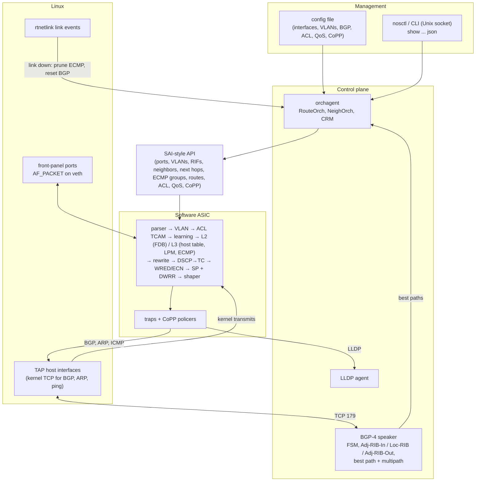

# NanoNOS

[](https://github.com/yasaswinivardhireddy-png/nanonos/actions/workflows/ci.yml)

A SONiC-style network operating system for data center switches, written in C++20 for Linux.
An orchestration agent programs a SAI-like hardware abstraction; behind it sits a software
ASIC pipeline with the tables a switch chip has (FDB, host table, LPM, ECMP groups, ACL TCAM,
egress queues and policers). BGP-4 and LLDP run as control-plane protocols, packets for the switch
itself reach the Linux kernel through TAP host interfaces, and the whole thing runs as a real
4-switch leaf-spine fabric in network namespaces in CI.

```
$ nosctl -s /tmp/nanonos-test/leaf1.sock show bgp summary    # end of the CI fabric test,
BGP router identifier 10.255.0.1, local AS 4200000001          # just after an uplink was restored

Neighbor         AS          State        Up/Down   PfxRcd PfxSnt MsgRcvd MsgSent
10.0.0.1         4200000100  Established  00:00:22  1      1      25      25
10.0.1.1         4200000100  Established  00:00:00  1      1      19      23

$ nosctl -s /tmp/nanonos-test/leaf1.sock show ip route
Codes: C connected, S static, B bgp; * offloaded to the ASIC, ! not offloaded

C* 10.0.0.0/31         directly connected, Ethernet4
C* 10.0.1.0/31         directly connected, Ethernet5
C* 10.1.1.0/24         directly connected, Vlan10
B* 10.2.2.0/24         via 10.0.0.1, 10.0.1.1

$ nosctl -s /tmp/nanonos-test/leaf1.sock show lldp neighbors
Local port   Neighbor            Neighbor port   Chassis id         TTL
Ethernet4    spine1              Ethernet0       02:00:95:ff:78:00  8
Ethernet5    spine2              Ethernet0       02:00:9c:ae:c2:00  8
```

## Results

All numbers come from GitHub Actions `ubuntu-24.04` runners and are re-measured on every push; see
the job summaries of the [CI runs](https://github.com/yasaswinivardhireddy-png/nanonos/actions/workflows/ci.yml).
GitHub-hosted runners differ in CPU model, so absolute numbers vary between runs, and the tables show
conservative figures. The data-plane table is from an AMD EPYC 7763 runner; on an AMD EPYC 9V45
runner the same benchmark measured 12.6 Mpps routed and 25.3 Mpps bridged.

**Leaf-spine fabric** (`scripts/test_clos.sh`: 4 `nanonosd` processes, 2 hosts, veth links)

| | |
|---|---|
| eBGP sessions (8, 4-octet ASNs, GTSM) Established after start | 1.6 s |
| Ping h1 → h2 across leaf, spine, leaf | reply TTL 61 (3 routed hops) |
| iperf3, 8 TCP flows through 3 userspace switches | 1.2 Gbit/s, split over both spines (217K / 313K packets) |
| Uplink cable pulled during a 10 ms ping | **0 of 1000 packets lost** |
| Cable restored | sessions and 2-path ECMP back within seconds |
| Layer 2 (`scripts/test_l2.sh`): bridging, 802.1Q trunk, VLAN isolation | pass, 1.4 Gbit/s bridged |
| Interop with FRRouting `bgpd` over TCP-MD5 (`scripts/test_frr_interop.sh`) | session up, routes both ways |

**Data plane** (`bench/bench_main.cc`, one core)

| Benchmark | Result |
|---|---|
| Full pipeline, routed + ECMP + ACL, 64-byte frames | 7.4 Mpps |
| Full pipeline, bridged + ACL, 64-byte frames | 14.0 Mpps |
| LPM lookups, 500K routes (random addresses, cache-missing) | 54 M/s |
| LPM lookups, 100K routes | 65 M/s |
| ACL lookups, 128 rules, worst case (no match) | 19.4 M/s |
| FDB fill before the first hash collision, 1 hash vs 2-choice cuckoo | 11.0% vs **91.4%** |
| Flows remapped when 1 of 8 ECMP paths fails, modulo vs resilient | 87.6% vs **12.6%** |
| Heap allocations per forwarded packet (`tests/alloc_test.cc`, 100K packets) | **0** |

**Testing**

| | |
|---|---|
| Unit tests | 65 GoogleTest cases, including a deterministic in-memory simulation of the whole 2x2 fabric |
| Builds | GCC and Clang with `-Werror`; Clang with AddressSanitizer + UndefinedBehaviorSanitizer |
| Other architectures | unit tests pass on ARM64 (aarch64) and big-endian s390x under QEMU |
| Fuzzing, 60 s per target under ASan/UBSan | packet parser 72M inputs, LLDP 68M, full switch pipeline 40M, config parser 35M, BGP decoder (with re-encode round trip) 10.5M; no crashes |

## Architecture



How the pieces map onto SONiC:

| SONiC | NanoNOS |
|---|---|
| CONFIG_DB + `config` commands | line-based config file (`src/orch/config.cc`) and runtime CLI commands |
| orchagent (RouteOrch, NeighOrch, CRM) | `src/orch/orchagent.cc` |
| SAI + syncd + vendor SDK | `src/sai/sai.h` implemented by the software ASIC `src/asic/vasic.cc` |
| `sairedis.rec` call recording | `src/sai/recorder.cc` |
| FRR bgpd + fpmsyncd | `src/proto/bgp_speaker.cc`, installing best paths through the orchagent |
| lldpd | `src/proto/lldp.cc` |
| hostif netdevs + trap groups + CoPP | TAP devices (`src/linux/tap_device.cc`) + per-trap srTCM policers |
| portsyncd / link state | rtnetlink monitor (`src/linux/netlink_monitor.cc`) |
| `show` commands | `nosctl` |

## Features

**Forwarding pipeline** (`src/asic/`)
- Ethernet, 802.1Q (access, trunk, native VLAN), ARP, IPv4, TCP/UDP/ICMP parsing with bounds checks
  and IPv4 header checksum validation; endian-independent field access.
- L2: MAC learning, moves, aging, static entries, flooding with split horizon. The FDB is a
  fixed-capacity bucketized hash with 2-choice cuckoo insertion, like ASIC exact-match tables.
- L3: routed ports and SVIs, a neighbor (host) table, LPM, TTL decrement with an incremental
  checksum update (RFC 1624), MAC rewrite, ARP glean for unresolved next hops.
- LPM: stride-8 multibit trie with controlled prefix expansion, at most 4 memory reads per lookup,
  a fixed node pool, and node reclamation when routes are removed.
- ECMP: next-hop groups with resilient hashing (256 buckets): when a member fails, only its flows
  move. CRC-32 5-tuple hash with a per-switch seed to avoid polarization between tiers.
- Fast failover: on link down the data plane prunes the dead next hops from every group before
  the control plane reacts.
- Drop reasons are counted individually (SONiC "debug counters"): `show drops`.

**QoS and switch security**
- DSCP → traffic class map, 8 egress queues per port, strict priority + deficit weighted round
  robin, port shapers, and WRED with ECN marking (as RoCEv2/DCQCN fabrics use).
- Ingress ACL modeled as a TCAM: value/mask entries over a packed key, priority order, L4 port
  ranges expanded into prefixes (`rule 10 deny tcp dst 10.1.0.0/16 dport 23`).
- Control-plane policing: every trap group (ARP, LLDP, BGP, ICMP, other ip2me) has its own srTCM
  policer (RFC 2697), so an ARP flood cannot starve BGP keepalives.
- Storm control (broadcast, multicast, unknown unicast) and port security (MAC limit per port).
- BGP sessions with TCP-MD5 (RFC 2385) and GTSM / TTL security (RFC 5082).

**Control plane**
- BGP-4 (RFC 4271) with 4-octet ASNs (RFC 6793): full FSM, connection-collision resolution,
  hold and keepalive timers with jitter, NOTIFICATION codes for every malformed message, best-path
  selection, multipath across equal-length AS paths (RFC 7938 fabrics), AS-loop prevention,
  enforce-first-as, sender-side loop detection, next-hop-self, and UPDATE packing.
- Fast external failover: a session over a link that goes down is reset immediately.
- LLDP (IEEE 802.1AB) transmit and receive with a neighbor table that ages out.
- orchagent: admin distance between connected, static and BGP routes; ref-counted next-hop and
  ECMP-group objects shared between routes; make-before-break route updates; routes the ASIC
  rejects with `TABLE_FULL` are kept and retried; CRM warnings at 85% table use.

**Linux runtime** (`src/linux/`, `src/tools/nanonosd.cc`)
- Single-threaded epoll event loop with timerfd ticks and signalfd shutdown.
- Front-panel ports are AF_PACKET sockets; VLAN tags the kernel moved into metadata are
  reinserted from `PACKET_AUXDATA`, as libpcap does.
- TAP host interfaces per router interface, so BGP uses the kernel TCP stack.
- rtnetlink monitoring turns carrier loss into port-down events.

## Design notes

- **Run to completion, no allocation per packet.** Tables, packet buffers and queues are sized at
  start-up. `tests/alloc_test.cc` replaces global `operator new` and forwards 100,000 routed,
  ECMP and bridged packets: zero allocations. The core builds with `-fno-exceptions`.
- **Hardware-shaped tables.** Exact-match tables fail on a full hash bucket before they are full,
  so the FDB uses two hash choices with cuckoo displacement (91% fill vs 11%). The LPM trie
  bounds lookup latency at 4 dependent reads, like an algorithmic LPM block.
- **TABLE_FULL is a normal event.** Inserts are all-or-nothing; the orchagent marks the route
  as not offloaded (`S!` in `show ip route`), keeps it, and retries when space frees up.
- **Resilient ECMP.** Modulo hashing reshuffles most flows when a path fails, which reorders TCP
  and forces RoCE retransmits; bucketed resilient hashing moves only the failed path's share.
- **The kernel terminates control traffic.** Instead of a userspace TCP stack, trapped packets go
  through TAP devices, the same split SONiC uses. One consequence found by the integration test:
  Linux answers a SYN with the listening socket's TTL, so GTSM needs TTL 255 on the listener.
- **Deterministic simulation.** The in-memory fabric test runs four complete switches with a
  manual clock and an in-memory BGP transport (byte-by-byte delivery, link cuts), so failover
  behavior is tested without timing flakiness.

## Build and run

```sh
cmake -S . -B build -G Ninja -DCMAKE_BUILD_TYPE=Release
cmake --build build
ctest --test-dir build --output-on-failure

# Linux, as root: the fabric demo and the other integration tests
sudo bash scripts/test_clos.sh
sudo bash scripts/test_l2.sh
sudo bash scripts/test_frr_interop.sh      # needs: apt-get install frr

./build/nanonos_bench                       # benchmarks
```

Run one switch by hand: `sudo ./build/nanonosd -c configs/clos/leaf1.conf -s /tmp/leaf1.sock`,
then `./build/nosctl -s /tmp/leaf1.sock show interfaces`. Every `show` command takes a trailing
`json`. Runtime changes: `interface Ethernet4 shutdown`, `ip route 10.9.0.0/16 10.0.0.1`,
`clear counters`.

Fuzzing (clang): `cmake -B build-fuzz -DCMAKE_CXX_COMPILER=clang++ -DNANONOS_BUILD_FUZZERS=ON`,
then run any of `fuzz_packet`, `fuzz_pipeline`, `fuzz_bgp`, `fuzz_lldp`, `fuzz_config`.

## Layout

```
src/common   types, byte order, hashing, logging, clocks
src/packet   parser, checksums, frame builders
src/asic     software ASIC: FDB, LPM, ECMP, ACL, QoS, policers, pipeline
src/sai      SAI-style switch API and call recorder
src/orch     configuration parser and orchagent
src/proto    BGP-4, LLDP, in-memory BGP transport for tests
src/sw       SwitchNode (ASIC + orchagent + protocols + CLI)
src/linux    epoll loop, AF_PACKET ports, TAP, rtnetlink, BGP over TCP, CLI socket
src/tools    nanonosd daemon, nosctl client
tests        unit tests, fabric simulation, zero-allocation test
fuzz         libFuzzer targets
bench        benchmarks
scripts      network-namespace integration tests
configs      example configurations (leaf-spine fabric, L2 switch)
```

## Limitations and next steps

IPv4 only. Single VRF. eBGP only (no iBGP, route reflection or policies). No BFD, PFC or PFC
watchdog, VXLAN/EVPN, or warm restart. The data plane is one core; a real deployment would shard
ports across cores with lock-free rings. BGP routes are programmed into the ASIC but not into the
kernel, so the switch's own traffic can only reach directly connected peers. Natural next steps:
BFD for sub-second failure detection on multi-hop paths, IPv6, P4Runtime as an alternative
programming interface, and PFC with a watchdog for lossless RoCE classes.

## License

MIT
